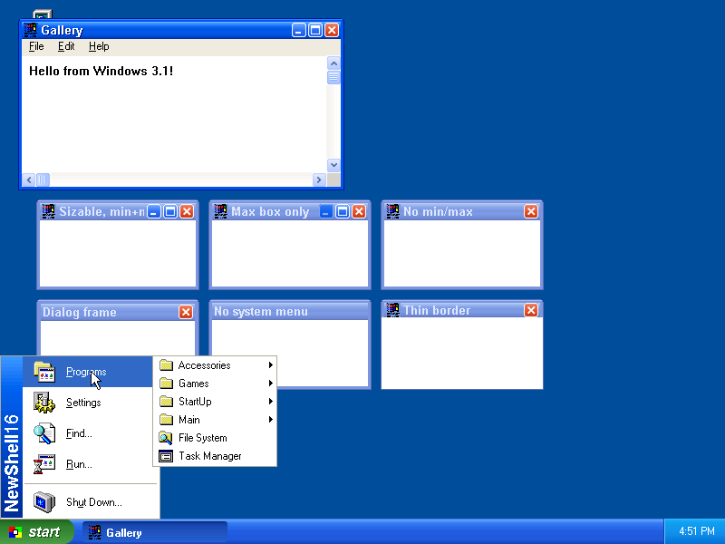
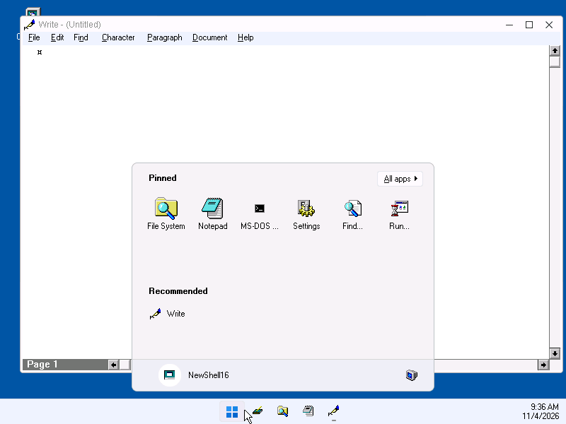

# NewShell16

A re-implementation of the [Calmira](https://en.wikipedia.org/wiki/Calmira)
shell for Windows 3.1x, written in plain C against the Win16 API.

The original Calmira (by Li-Hsin Huang) was written in Delphi 1 and brought a
Windows 95-style desktop to Windows 3.1. NewShell16 recreates that
experience as a small, native 16-bit C program.

## Status

Usable as the Windows 3.1 shell, with nearly all of Calmira's features:

- **Taskbar** with Start button, a button per application (icon, click to
  activate/minimise, right-click for its system menu with Window Info and
  Terminate), a tray, a clock with the date as a hint, auto-hide, an
  exclusion list, and a menu to cascade/tile/minimise windows and show
  the desktop. Minimised windows are kept off the desktop and maximised
  windows stop above the taskbar.
- **Quick Launch** bar beside the Start button, as in Windows 98: Show
  Desktop and program buttons from `NSSTART.INI`.
- **Start menu** in Calmira's START.INI format (`NSSTART.INI`), created
  from the Program Manager groups on first use, with icons at every level,
  Calmira's 3D look or a plain menu, and an editor (Start Menu Properties).
  Setup programs add their groups to it over DDE, as they would to
  Program Manager. With the XP look it is the two-column Windows XP Start
  menu: pinned programs, the programs started last, All Programs, the
  first level of the menu on the right, Log Off and Shut Down (also
  available without the XP look).
- **Desktop** with Computer, Bin and shortcuts made by dragging files,
  folders, drives or programs onto it (shortcut properties, Change Icon,
  Calmira's arrows, a grid), and a right-click menu.
- **Folder windows** and the **Computer** window: large icon, small icon,
  list and details views (a table with resizable and optional columns,
  including the descriptions of `DESCRIPT.ION`, which Describe edits),
  sorting, multiple and rubber-band selection, type-ahead, filters,
  Select Files, Go To, a toolbar, hints with file details, inline rename,
  new folder, cut/copy/paste, delete (to the Bin) and Undelete, Open With,
  Inspect, Print, aliases (Calmira's `.ALS` files), properties (with
  version information, the program that opens a file, and a pie for
  drives), drag and drop with either mouse button between windows, onto
  folders, programs, the desktop and the Bin, and drops from File Manager.
- **File System**: folder tree beside a folder view, with a toolbar and a
  two-part status bar; the tree has Calmira's menu (expand branches,
  share folders with Windows for Workgroups...). **Browse Folders** shows
  the tree alone.
- **Bin**: deleted items can be restored or deleted for good; a capacity,
  emptying when Windows exits.
- **Task Manager** (Ctrl+Esc): switch to, hide, minimise, end or terminate
  tasks, start new ones, cascade and tile.
- **Find** files and folders by name and contents, with a menu on the
  results.
- Run (with history and MS-DOS windows), Shut Down, Properties, Options
  (pages for every setting), Tip of the Day and About dialogs.
- Hot keys, the Windows key (Win+E, Win+R...), sounds for events, web
  addresses opening in a browser, users with their own settings, a splash
  and a shutdown screen, and the folder windows of the last session.
- Folder windows refresh by themselves when files change.
- **Long file names**, as in Calmira LFN: with a DOS long file name
  driver ([LFNTSR](https://github.com/ceisserer/lnf286), which Setup can
  add to `AUTOEXEC.BAT`, DOSLFN, LFNDOS, or Windows 95's MS-DOS 7) folder windows, the
  tree, Find, Properties, the Bin, rename, copy and move use long names;
  programs still get 8.3 names. Without one everything works with 8.3
  names.
- **Open and Save As dialogs** of Windows 95, XP or 11 (following the
  theme) for every Windows 3.1 program, with long names, returning 8.3
  names (`NSDLG.DLL`); programs with their own dialog hooks (Write,
  Paintbrush) keep the old dialog, which then shows long names too.
- As the shell it runs `load=`/`run=` and the StartUp group.

It looks consistent both on a plain Windows 3.1 and with the
[Retheme16](https://github.com/ceisserer/win31_theme_engine) Windows 95
theme engine. With Retheme16's RedmondExperience theme (the Windows XP
"Luna" look) the taskbar and the Start menu turn into the Windows XP ones:
a green Start button, a blue taskbar with rounded task buttons, a light
blue tray and the two-column Windows XP Start menu (best with a display
driver for 65536 colours, see [docs/testing.md](docs/testing.md)).



With Retheme16's Redmond-11 theme the taskbar becomes the Windows 11 one:
a light bar with the Start button, Quick Launch and the programs as icons
in the middle, the clock with the date, and the Windows 11 Start menu
(pinned programs, All apps, Recommended, the power button).



See [docs/design.md](docs/design.md) for internals, configuration and the
roadmap, and [docs/calmira-parity.md](docs/calmira-parity.md) for what
Calmira has that NewShell16 does not have yet.

## Building

Install [Open Watcom 2.0](https://github.com/open-watcom/open-watcom-v2),
then:

```sh
export WATCOM=/opt/watcom PATH=/opt/watcom/binl64:$PATH
wmake
```

Details in [docs/building.md](docs/building.md).

## Installing

Unzip a release (or `wmake release`, see
[docs/building.md](docs/building.md)) and run `SETUP.EXE` from Windows. Setup
can make NewShell16 the Windows shell and optionally installs the Retheme16
Windows 95 look with a theme of your choice; both can be changed later by
running Setup again from the NewShell16 group. `SETUP /?` lists the switches
for silent installation.

By hand:

1. Copy `build/newshell.exe` and `build/nshook.dll` to a directory, e.g.
   `C:\NEWSHELL\`.
2. In `SYSTEM.INI`, `[boot]` section, set
   `shell=C:\NEWSHELL\NEWSHELL.EXE`.
3. Optionally also set `taskman.exe=C:\NEWSHELL\NEWSHELL.EXE` so Ctrl+Esc
   opens NewShell16's Task Manager (or the Start menu, see Options).

NewShell16 can also be started from Program Manager to try it out; then
*Shut Down → Close NewShell16 only* closes it again.

### Trying it in an emulator

You need your own copy of Windows 3.1 (see
[docs/reference-media.md](docs/reference-media.md)) and the floppy image of
a [release](https://github.com/ceisserer/NewShell16/releases):

```sh
V=0.4.0
curl -LO https://github.com/ceisserer/NewShell16/releases/download/v$V/newshell-$V-disk.img
```

**DOSBox-X** (or DOSBox Staging, with `dosbox` instead of `dosbox-x`) with
the pre-installed `Win_31.zip`: unpack its `WINDOWS` directory into a
directory that becomes drive C:, then start Windows with Setup from the
floppy:

```sh
mkdir -p ~/win31 && unzip -q Win_31.zip -d ~/win31/zip
mkdir -p ~/win31/c && cp -r ~/win31/zip/Win/WINDOWS ~/win31/c/
# WIN.INI in Win_31.zip ends in NUL bytes, which hide every section added
# to it later (settings of all programs, Setup's update across a restart)
sed -i 's/\x0//g' ~/win31/c/WINDOWS/*.INI

dosbox-x -c "mount c $HOME/win31/c" -c "imgmount a $PWD/newshell-$V-disk.img -t floppy" \
         -c "c:" -c "cd \\windows" -c "win a:\\setup.exe"
```

Setup installs to `C:\NEWSHELL` and restarts Windows with NewShell16 as the
shell. Later sessions need only
`dosbox-x -c "mount c $HOME/win31/c" -c "c:" -c "cd \\windows" -c "win"`.
The installation lives in `~/win31/c`; delete it to start over.

**QEMU**: `tools/qemu/mkimage.sh` makes a Windows 3.1 image with the
NewShell16 and Retheme16 setups on it from the Windows 3.1 and MS-DOS
archives, and `tools/qemu/run.sh` starts it (see
[tools/qemu/README.md](tools/qemu/README.md)). By hand, QEMU needs a bootable hard disk image with DOS and Windows 3.1 (for
example installed from the Windows 3.1 and MS-DOS floppies). Attach the
NewShell16 floppy, boot, and run `win a:\setup.exe` at the DOS prompt:

```sh
qemu-system-i386 -m 16 -hda win31.img -fda newshell-$V-disk.img
```

**In the browser (PCjs)**: `tools/pcjs/mkpcjs.py` builds a static web page
from the same archives that runs Windows 3.1 with NewShell16 installed in
[PCjs](https://www.pcjs.org), on an emulated IBM PC AT (286, 4 MB, VGA
640x480 in 16 colours; see [tools/pcjs/README.md](tools/pcjs/README.md)).

## Testing

[docs/testing.md](docs/testing.md) describes the DOSBox-X harness used to
boot Windows 3.1 with NewShell16 and take screenshots.

## Layout

```
src/        C sources and headers
res/        resource script, icons, bitmaps
tools/      icon generator, emulator test harness, release script
dist/       installer description (SETUP.INF) and the user README
external/   Win16Setup and Retheme16 (git submodules)
docs/       documentation
```

## License

NewShell16 is free software, licensed under the
[GNU General Public License, version 3 or later](COPYING).

It is a re-implementation of Calmira (Copyright © Li-Hsin Huang and the
Calmira contributors), which is licensed under the GNU GPL version 2 or (at
your option) any later version. Calmira's sources were used as a reference
for behaviour and file formats, and most icons and small images are
Calmira's (`res/calmira/`).
