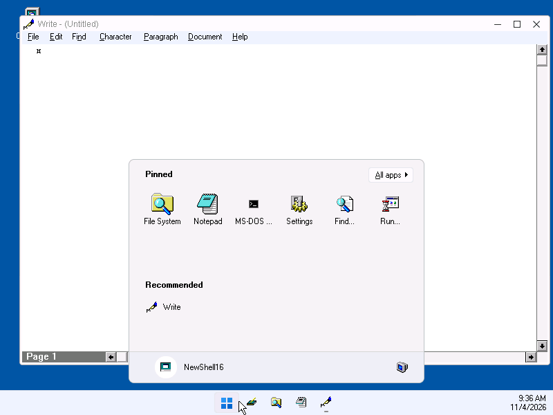
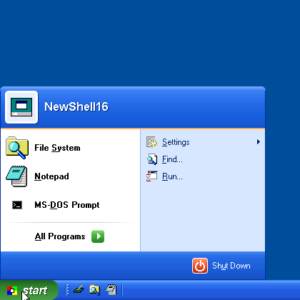
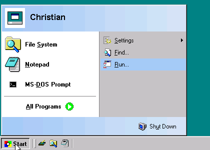

# Design notes

NewShell16 recreates [Calmira](https://en.wikipedia.org/wiki/Calmira)
(originally Delphi 1) as a plain C Win16 program. Everything is a single
executable, `NEWSHELL.EXE`.

## Modules

| File | Purpose |
|------|---------|
| `main.c` | `WinMain`, hidden main window, shell detection, hook DLL loading, start-up programs, second-instance forwarding |
| `taskbar.c` | Taskbar window: Start button, Quick Launch, task buttons, clock, task system menus |
| `startmnu.c` | Owner-drawn Start menu from `NSSTART.INI`, `$` macros, the programs started last |
| `startxp.c` | The two-column Start menu of Windows XP (pinned and recent programs, All Programs, Log Off, Shut Down) and the Windows 11 Start menu |
| `startprop.c` | Start Menu Properties: the Start menu as an editable tree, its look |
| `progman.c` | `PROGMAN.INI` / `*.GRP` reader, `load=`/`run=`, StartUp group |
| `dde.c` | Program Manager DDE server for setup programs |
| `desktop.c` | Desktop icons (Computer, Bin, shortcuts), desktop menu, drops on the desktop |
| `shortcut.c` | Shortcut Properties and Change Icon dialogs |
| `alias.c` | Aliases (`.ALS` files in Calmira's format) |
| `fview.c` | Folder view control: views, selection, rubber band, rename, clipboard, drag and drop, hints |
| `folddlg.c` | Select Files, Set Filter, Go To, Open With, Describe, Columns; `DESCRIPT.ION` |
| `folder.c` | Folder windows and the Computer window (frames around a folder view) |
| `explorer.c` | File System and Browse Folders windows: folder tree plus folder view |
| `toolbar.c` | Toolbar of folder and File System windows |
| `fileops.c` | Copy, move, delete, rename, new folder; progress, replace and confirmation dialogs |
| `bin.c` | The Bin, its window and its properties |
| `props.c` | Properties dialog: files, folders, drives (pie), selections, version, association |
| `taskman.c` | Task Manager, cascade and tile |
| `find.c` | Find dialog: names, contents, result menu |
| `icons.c` | File icon lookup and caching |
| `dialogs.c` | Run, Shut Down, About |
| `options.c` | The Options dialog |
| `system.c` | Sounds, web addresses, splash and shutdown screens, Tip of the Day, help, saved windows |
| `users.c` | Users: logon dialog, per-user settings |
| `settings.c` | `NEWSHELL.INI` |
| `util.c` | 3D drawing, small images, colours, hints, path helpers, launching, reading the active theme |
| `luna.c` | The Windows XP ("Luna") look of the taskbar, Start button and Start menu; which look is used |
| `win11.c` | The Windows 11 look of the taskbar |
| `nshook.c` | `NSHOOK.DLL`: system hooks (see below) |
| `lfn.c` | Long file names: the LFN API of INT 21h (71xxh), with 8.3 fallbacks (also in `NSDLG.DLL`) |
| `nsdlg.c` | `NSDLG.DLL`: the Open and Save As dialogs of Windows 95, XP and 11 for every program |

## Windows 3.1 specifics

- **Hooks.** System-wide hooks must live in a DLL, so like Calmira's
  `WNDHOOKS.DLL` there is `NSHOOK.DLL`. It provides a shell hook (window
  created/destroyed, for an immediate taskbar update), a `WH_CALLWNDPROC`
  hook that shrinks the maximised size in `WM_GETMINMAXINFO` so windows
  stop above the taskbar, a subclass of the desktop window for the
  right-click menu and for files dropped from File Manager, a keyboard
  hook for the Windows key and hot keys, a `WH_GETMESSAGE` hook that
  closes windows on a right click on their minimise or maximise box,
  and the undocumented `KERNEL.FileCdr` callback for file system
  changes. Without the DLL NewShell16 still works; the taskbar then
  relies on its timer.
- **Program Manager DDE.** Setup programs create their groups by DDE
  with Program Manager (service and topic `PROGMAN`). As the shell,
  NewShell16 answers in its place with plain DDE messages (which DDEML
  clients understand), one hidden window per conversation, and turns
  the commands into submenus of Programs in `NSSTART.INI`.
- **One data segment.** Windows 3.1 runs a program with several data
  segments only once, and Ctrl+Esc relies on a second copy of
  NEWSHELL.EXE handing its command line to the first. String literals
  therefore go into the code segments (`-zc`) and large tables are
  allocated from the global heap.
- **Task list.** The taskbar also polls the top-level windows (visible,
  unowned, with a caption) from a 500 ms timer to catch title changes.
  The Retheme16 engine's window (class `Retheme16`), which only exists so
  the engine can be closed, gets no task button; Task Manager lists it.
- **Minimised windows** would normally show as icons on the desktop; with
  `HideMinApps=1` their icon position is moved below the screen with
  `SetWindowPlacement` (as Calmira does) and they are reached through the
  taskbar instead.
- **Desktop colour.** As the shell, NewShell16 sets the desktop to the
  Windows 95 teal for the session while `WIN.INI` has no `[colors]`
  `Background=` (no colour chosen in Control Panel); nothing is written.
- **Desktop icons** are small popup windows forced to the bottom of the
  Z-order; their background is drawn with `USER.PaintDesktop` so the
  wallpaper shows through. Alt+F4 on them (or on the taskbar) opens Shut
  Down.
- **Icons are 32x32 only** in Windows 3.1. Small versions for task buttons,
  menus and lists are made by drawing into a memory DC and `StretchBlt`-ing.
- **Ctrl+Esc** starts `taskman.exe=` from `SYSTEM.INI`. If that points at
  `NEWSHELL.EXE`, the second instance forwards the request to the running
  copy, which opens the Task Manager (or the Start menu).
- **The Bin** uses a hidden `NSBIN` folder on the root of each fixed
  drive, so sending something to the Bin is a rename. `NSBIN\NSBIN.INI`
  records where each item came from.
- As the shell, NewShell16 performs Program Manager's start-up duties: the
  `WIN.INI` `load=`/`run=` lines and the StartUp group (skipped while Shift
  is held).

## Look and feel, with and without a theme engine

NewShell16 draws its own parts (taskbar, Start menu, folder views, status
bars, pane edges) in the Windows 95 style, and leaves menus, captions and
dialog controls to Windows. It is meant to look consistent both on a
plain Windows 3.1 and with the
[Retheme16](https://github.com/ceisserer/win31_theme_engine) engine, which
restyles those system parts:

- **Menus.** The owner-drawn Start menu uses the font the system menus
  use: the theme's `Menu` font while the engine runs (`RETHEME.DLL`
  loaded; the font is read from the theme's `THEME.INI`, following
  `Base=`), otherwise the bold System font of Windows 3.1. As in
  Calmira's 3D Start menu, items use the button-face colour, the first
  level has 32x32 icons and a banner (a gradient towards the active
  caption colour), and separators are etched. Without the engine the
  items also paint a raised Windows 95 frame: its inner lines are part of
  the items, and its outer lines are drawn over the black menu border
  Windows 3.1 draws (the owner-draw DC is not clipped to the item). Items
  are painted into a memory bitmap and blitted, so the engine, which
  redraws text and fills on menu DCs, cannot reinterpret them. Item
  heights follow the font.
- **Context menus** are owned by top-level windows (the engine only
  restyles menus of top-level windows), so they match the menu bars.
- **Controls** are only placed in dialogs (the engine themes controls in
  dialogs only): the Task Manager is a dialog, like Run, Find, Properties,
  Options and Shut Down. Lists in ordinary windows (File System tree, Bin)
  are borderless and sit in a sunken Win95 pane edge drawn by NewShell16,
  instead of the black 3.1 border.
- **Taskbar menus** are moved above the taskbar once they are on screen
  (Windows 3.1 has no `TPM_BOTTOMALIGN`).
- **Icons** of windows without a class icon (dialogs) come from
  `WM_QUERYDRAGICON`.
- **Desktop icon labels** use the icon title font from the Control Panel
  (`SPI_GETICONTITLELOGFONT`).

### The Windows XP look

When the running Retheme16 theme has `[Shell] Style=XP` in its
`THEME.INI` (Retheme16's RedmondExperience theme, `THEMES\WINXP`; `Base=`
is followed), `luna.c` draws the taskbar in the Windows XP "Luna" style: a
blue gradient bar, a green Start button with rounded right corners filling
the height of the bar and "start" in white italics, rounded light blue task
buttons (dark blue for the active task), a light blue tray, white text. The
Start menu gets white items, a light-to-dark blue banner and flat grey
separators; the engine draws the white menu border.

`[Taskbar] Look=` overrides the theme: 0 follows it, 1 always uses the XP
look (also without the engine), 2 never. The look is re-read when system
colours change (the theme engine sets and restores them when it starts and
stops), when `WIN.INI` changes, and when the 500 ms taskbar timer sees the
engine start or stop. The colour settings of `[Colors]` (taskbar, Start
menu) do not apply to the XP look.

Everything is drawn procedurally into the taskbar's memory bitmap:
gradients row by row with `ExtTextOut(ETO_OPAQUE)`, rounded corners
anti-aliased by blending with the pixels below (4 x 4 samples per corner
pixel). Small icons over the gradient are drawn into an enlarged copy of
the background and shrunk back, so the gradient shows through. There are
no bitmaps, the code is a separate discardable segment (see
[building.md](building.md)) and the data segment grows by 16 bytes, so
the classic look costs little extra. The
gradients want a 15/16/24-bit display; GDI dithers them with 16 or 256
colours.

### The Windows 11 look

With Retheme16's Redmond-11 theme (`[Shell] Style=11`, `THEMES\WIN11`), or
`[Taskbar] Look=3`, `win11.c` draws the taskbar of Windows 11: a light bar
8 pixels taller than the others (windows and desktop icons follow when the
look changes), the Start button (four blue panes), the Quick Launch
buttons and the task buttons as icons centred on the bar, light rounded
squares under the mouse and behind the active task, a short grey line under
running tasks and a longer blue one under the active task (the titles are
in the hints), and the clock with the date below the time.

The Start menu is then the Windows 11 one, centred above the taskbar: a
grid of pinned programs (`[Pinned]`, then the first level of
`NSSTART.INI` except Programs and Shut Down; up to 18), All apps (the
Programs submenu), Recommended (the programs started last) and a footer
with the user (Log Off when there are users) and the power button (Shut
Down). It is the panel of the two-column menu with another layout; the
arrow keys move to the nearest item in their direction.



### The two-column Start menu

With the XP look (or always, with `[Start Menu] Style=2`) the Start button
opens the Windows XP Start menu (`startxp.c`) instead of the classic one:
a header with a picture and the user's name, a white left column with the
pinned programs (`[Pinned]` in `NSSTART.INI`, large icons, bold) and the
programs started last from the Start menu (`[Recent]`, up to five, kept by
`startmnu.c`), All Programs at its bottom (the Programs submenu), a light
blue right column with the first level of `NSSTART.INI` except Programs
and Shut Down, and a footer with Log Off (when there are users) and Shut
Down.




It is a popup window with a modal loop of its own, like a menu: it holds
the mouse capture (a click outside closes it, also on the Start button)
and the keyboard (arrows move in a column, Left/Right change columns,
Enter, Esc, mnemonics). Submenus (All Programs, Settings...) are the
ordinary owner-drawn popup menus of the classic Start menu, opened by a
click, the Right key or after resting the mouse on the item for a moment.
A click opens them when the button is released (a popup menu opened while
the button is down would close again on the release), and they open above
the taskbar, All Programs upwards from the bottom of the panel as in
Windows XP. With the XP look the green arrow of All Programs, the user
picture's frame and the icons of Log Off and Shut Down are drawn in
`luna.c`, in true colour.
The command chosen is posted to the taskbar after the window is gone.
Without the XP look the menu uses the system colours (caption gradient,
window and Start menu colours), like the classic style of Windows XP.

### Quick Launch

The Quick Launch bar of the Windows 98 shell (IE4 Desktop Update) sits
between the Start button and the task buttons: a separator and grip,
small flat buttons that rise under the mouse, a separator. Its buttons are
`[Quick Launch]` in `NSSTART.INI`, in the Start menu's format; by default
Show Desktop (`$ClearDesktop`, again restores the windows), File System and
Notepad. The taskbar's right-click menu switches it on and off and opens
`NSSTART.INI` in Notepad (Edit Quick Launch); the section is read again
when it changes. With the XP look the buttons sit on the blue bar and use
the rounded task button shape.

## Long file names

Windows 3.1 has no long file names, but DOS can have them: Windows 95's
MS-DOS 7, and under MS-DOS 6 the drivers
[LFNDOS](https://www.ibiblio.org/pub/micro/pc-stuff/freedos/files/repositories/latest/pkg-html/lfndos.html)
(GPL) and [DOSLFN](https://github.com/adoxa/doslfn) (freeware with source)
provide the LFN API of INT 21h (functions 71xxh: find first/next with long
and short names, 7160h for the long and short form of a path, rename,
create, delete...). This is what Calmira LFN used. DOSBox-X has it built
in (`[dos] lfn=true`).

`lfn.c` calls these functions in real mode through DPMI ("simulate real
mode interrupt", INT 31h 0300h) with the strings in a 1 KB buffer from
`GlobalDosAlloc`: Windows 3.1 translates the pointers of the DOS functions
it knows only, and a driver loaded before Windows lives in real mode. Under
Windows 95 the same calls reach IFSMgr. Whether a drive has long names is
asked with 71A0h (volume information, bit 14) once per drive; floppies are
asked again while they say no.

Every function falls back to the DOS function of 8.3 names when there is
no driver, the drive has no long names (network, CD-ROM without Joliet
support) or `[Folders] LongNames=0`, so the rest of the shell has one code
path.

**8.3 paths stay the shell's own.** Internally, in the INI files, in
shortcuts and towards Windows (`WinExec`, `ShellExecute`, file handles)
NewShell16 keeps using 8.3 paths, which every Windows 3.1 program
understands. Long names are what the user sees and types:

- Folder views read with 714Eh and keep each item's long name in a pool
  next to its 8.3 name; they show, sort, type-ahead and filter by it. The
  hint shows the 8.3 name too. Window titles show the long path (7160h).
- Rename takes a long name on drives with long names (7156h), else an 8.3
  name as before. New Folder makes "New Folder", "New Folder (2)"...
- Copy and move give the copy the long name of the original: the file is
  created under it (716Ch), then filled through its 8.3 name; folders with
  7139h. A move on the same drive is a rename (7156h), which keeps it.
  Delete uses 7141h/713Ah, so no orphaned long name entries are left.
- The Bin records the long path (`[Long]` in `NSBIN.INI`) and restores the
  item under its long name, also into folders that have to be made again.
- The File System tree, Find (matches long or 8.3 names), Properties (the
  long name and the MS-DOS name), desktop shortcuts (the caption), Go To,
  Find's folder and Run (`"C:\Long Folder\Program.exe" args`) take or show
  long names; dropped long paths are turned into 8.3 ones.

With Windows for Workgroups 3.11, 32-bit file access must be off when a
DOS driver provides the long names (VFAT would bypass it).

**DOSLFN in Setup.** The release carries DOSLFN 0.42a (`DOSLFN.COM`,
`LFNXLAT.386`, its documentation; `dist/DOSLFN`, unchanged from its
release). Setup's option "Long file names in DOS" (`/LFN`, off by default,
greyed out on a 286) adds `C:\NEWSHELL\DOSLFN\DOSLFN.COM` to
`AUTOEXEC.BAT` before the line starting Windows and offers to restart the
computer; Win16Setup keeps `AUTOEXEC.W16` and removes exactly that line
when the option is turned off or NewShell16 is removed (`Autoexec1=`,
`Reboot=1`, `MinCPU=386` in `dist/SETUP.INF`). Under Windows 3.1 DOSLFN
loads `LFNXLAT.386` from its directory by itself; with WfW's 32-bit file
access it gives hard disks no long names instead of bypassing VFAT.

## The Open and Save As dialogs (NSDLG.DLL)

`NSDLG.DLL` replaces the Open and Save As dialogs of every program with
those of Windows 95, Windows XP or Windows 11, following the look of the
shell (the Retheme16 theme's `[Shell] Style=`) or `[FileDialog] Style=`.

**Patch.** `NsDlgInstall()`, called by NEWSHELL.EXE, loads COMMDLG.DLL
and writes `JMP FAR` over the first five bytes of `GetOpenFileName`
(ordinal 1) and `GetSaveFileName` (2), as Retheme16 patches USER and GDI:
the code segment is fixed and page-locked and written through a data
alias from `AllocSelector`/`PrestoChangoSelector`. The handlers run in the
calling program's task and on its stack, so the dialog's state (about
13 KB), its items and the long name pool are on the global heap. The DLL's
own code and data are fixed. NewShell16 removes the patch when it ends; if
it crashes, Windows unloads the DLL and its WEP removes it.

**Compatibility.** A program with `OFN_ENABLEHOOK`, `OFN_ENABLETEMPLATE`
or `OFN_ENABLETEMPLATEHANDLE` (Write, Paintbrush...) expects COMMDLG's
controls: it gets the original dialog (the JMP is lifted while it runs).
Everything else is answered as COMMDLG would: `lpstrFile` with an 8.3
path, the Windows 3.1 format of multiple selection (`C:\DIR A.TXT
B.TXT`), `nFileOffset`, `nFileExtension`, `lpstrFileTitle`,
`nFilterIndex`, `lpstrCustomFilter`, `OFN_READONLY`,
`OFN_EXTENSIONDIFFERENT`, `lpstrDefExt`, `OFN_FILEMUSTEXIST`,
`OFN_PATHMUSTEXIST`, `OFN_CREATEPROMPT`, `OFN_OVERWRITEPROMPT`,
`OFN_HIDEREADONLY`, `OFN_SHOWHELP` (the `commdlg_help` message),
`OFN_NOCHANGEDIR`; the current directory is set as COMMDLG sets it.
The controls have COMMDLG's ids (`edt1`, `cmb1`, `lst1`, `chx1`).

**Long names to 8.3 names.** Names are shown and typed long; what the
program gets is the 8.3 alias. Saving under a new long name creates the
file first (716Ch, empty) so that it has an alias, as Windows 95's
dialog does for 16-bit programs; the program then overwrites it by its
8.3 name, which keeps the long name. Without long names the dialog is the
same with 8.3 names, and names that are not valid 8.3 names are refused.

**Looks.**

- *95*: Look in (an owner-drawn list of the drives and the path), Up One
  Level, Create New Folder, List and Details, the file list, File name,
  Files of type, Open as read-only. Fixed size, as in Windows 95.
- *XP*: the same with Back, a Views button and the places bar (My
  Computer, My Documents, Windows and `[FileDialog] Place1..6=Caption|Path`);
  resizable, its size is kept.
- *11*: Back and Up, an address bar whose parts can be clicked, a search
  box (filters the folder as you type), New folder and the view, a
  navigation pane (Quick access, This PC with the drives), details view,
  the name and type on one line, the buttons below; resizable.

The list (class `NsDlgList`) shows list or details view with icons (the
program's own for `.EXE`, the associated program's for documents, looked
up once per extension), multiple selection with Ctrl and Shift,
type-ahead, Backspace (up), F2 (rename) and F5. My Documents is
`[FileDialog] Documents=`, else `C:\My Documents` or `C:\DOCS`.

```ini
[FileDialog]
Style=0            ; 0 as the shell look, 1 Windows 95, 2 XP, 3 11,
                   ; 4 the Windows 3.1 dialogs
Documents=         ; the My Documents place
Place1=Projects|D:\Projects  ; more places (up to 6)
View95=0           ; 0 list, 1 details (also ViewXP, View11)
WidthXP=           ; the size of the resizable dialogs (also Width11...)
```

## Command line

| | |
|---|---|
| `NEWSHELL` | (when running) Task Manager, or Start menu with `CtrlEscStart=1` |
| `NEWSHELL /S` | Start menu |
| `NEWSHELL /E [path]` | File System window |
| `NEWSHELL /D` | show the desktop (minimise everything; again: restore) |
| `NEWSHELL path` | open a folder, document or program |

## NSSTART.INI

The Start menu uses Calmira's `START.INI` format, so existing Calmira menus
can be copied over:

```ini
[Start]
&Programs*=;;0;<programs>;0       ; '*' = submenu, items in [Start\&Programs]
&Run...=$Run;;0;<run>;0
-1=;;0;;0                         ; separator
Sh&ut Down...=$ShutDown;;0;<shutdown>;0

[Start\&Programs\Accessories]
Notepad=notepad.exe;;0;;0         ; command;directory;show;iconfile;iconindex
```

`show` is 0 (normal), 1 (minimised) or 2 (maximised). `iconfile` can be an
executable or icon file, or a built-in image: `<programs>`, `<documents>`,
`<settings>`, `<find>`, `<run>`, `<shutdown>`, `<system>`, `<folder>`,
`<help>`, `<printer>`, `<control>`, `<explorer>`, `<bin>`, `<taskman>`,
`<favorites>`, `<internet>`, `<showdesktop>`, `<logoff>`...

Built-in commands: `$Run`, `$ShutDown`, `$Find`, `$Explore [path]`,
`$BrowseFolders`, `$System` (Computer), `$Bin`, `$TaskManager`,
`$Folder path`, `$MinimizePrograms`, `$ClearDesktop`, `$CascadeBrowsers`,
`$CloseBrowsers`, `$ArrangeIcons`, `$LineUpIcons`, `$ScreenSaver`,
`$ToggleTaskbar`, `$Tips`, `$Help`, `$TaskbarProp`, `$DesktopProp`,
`$FileSystemProp`, `$SystemProp` (pages of the Options), `$StartMenuProp`,
`$BinProp`. They can also be used for desktop shortcuts, aliases and hot
keys. Commands starting with `http://`, `ftp://`, `www.` and the like
open in the web browser.

Settings > Start Menu (`$StartMenuProp`) edits the menu as a tree and
writes `NSSTART.INI` anew. Setup programs add their groups to Programs
over DDE.

Two more sections in the same format belong to the two-column Start menu
and the taskbar; they are created once (`PinnedMade=`, `QuickLaunchMade=`
in `NEWSHELL.INI`), so emptying them is kept:

```ini
[Pinned]                          ; left column of the two-column menu
File &System=$Explore;;0;<explorer>;0
&Notepad=NOTEPAD.EXE;;0;;0

[Quick Launch]                    ; buttons beside the Start button
Show Desktop=$ClearDesktop;;0;<showdesktop>;0
Notepad=NOTEPAD.EXE;;0;;0

[Recent]                          ; written by NewShell16: name|item
1=Write|WRITE.EXE;;0;C:\WINDOWS\WRITE.EXE;0
```

## NEWSHELL.INI

Nearly every option is in the Options dialog (Start > Settings >
Taskbar); the look of the Start menu is in Start Menu Properties.

```ini
[Taskbar]
Clock=1            ; show the clock
HideMinApps=1      ; move minimised windows off screen
MinAbove=0         ; (HideMinApps=0) icons of minimised windows above the bar
MaxClamp=1         ; keep maximised windows above the taskbar
CtrlEscStart=0     ; Ctrl+Esc: 0 = Task Manager, 1 = Start menu
WinKey=1           ; Windows key: Start menu, Win+E/R/F/M/D/Tab
AutoHide=0         ; slide away, back when the mouse reaches the bottom
AnimSteps=6
Enabled=1          ; 0: no taskbar
Hints=1            ; captions, date and resources as hints
DocFirst=0         ; "README.TXT - Notepad"
LowerDoc=0         ; ... "readme.txt - Notepad"
Exclude=           ; programs (module names) without a button
Tray=              ; programs shown as icons beside the clock
Look=0             ; 0 as the theme says ([Shell] Style=XP or 11), 1 Windows
                   ; XP, 2 Windows 95, 3 Windows 11
QuickLaunch=1      ; the Quick Launch bar ([Quick Launch] in NSSTART.INI)

[Desktop]
Icons=1
Menu=1             ; right-click menu on the desktop
SnapToGrid=1
SingleClick=0
ShortcutArrows=1
RightClose=0       ; right click on minimise/maximise boxes closes
ComputerCaption=Computer
BinCaption=Bin
Shortcut1=Notepad|NOTEPAD.EXE
Shortcut2=Documents|$Folder C:\DOCS
Shortcut3=Write|WRITE.EXE|C:\DOCS|2|PROGMAN.EXE|5
                   ; caption|command|folder|show (0 1 2)|icon file|icon index

[Folders]
NewWindow=1        ; open sub-folders in new windows
ShowHidden=0
Toolbar=1
StatusBar=1
FlatToolbar=0
FileMonitor=1      ; refresh folders when files change
View=0             ; 0 large icons, 1 small icons, 2 details, 3 list
Columns=140,70,80,72,64,64,180  ; details: Name, Size, Type, Date, Time,
                   ; Attributes, Description (dragged in the header)
HiddenColumns=0    ; bit n switches column n off (View > Columns)
Sort=0             ; 0 name, 1 type, 2 size, 3 date
Capitalize=0       ; "Calc.exe"
HideExtensions=0   ; no .EXE for programs with their own icon
LongNames=1        ; long file names where a driver provides them
ShadeSelected=1
FileHints=1
WindowPos=0        ; new windows: 0 Windows, 1 cascaded, 2 like the last one
SaveWindows=0      ; reopen the windows of the last session
Inspect=NOTEPAD.EXE
DeleteToBin=1
ConfirmDelete=1
ConfirmCopy=0      ; before copying or moving
ConfirmReplace=1   ; each replaced file
ConfirmFolders=1   ; copying into an existing folder
ConfirmProtected=1 ; read-only, hidden and system files
AskOnDrop=0        ; Move / Copy / Alias menu after every drag
DragCopy=0         ; drags copy unless Shift is held

[Explorer]
Split=170          ; width of the File System window's folder tree
Toolbar=1          ; View > Toolbar
StatusBar=1        ; View > Status Bar
RememberLast=1     ; open at the last folder (Last=)

[Start Menu]
Style=0            ; 0 as the taskbar look: two columns (Windows XP) with the
                   ; XP look, Windows 11 with the Windows 11 look, else
                   ; classic; 1 always classic; 2 always two columns;
                   ; 3 always Windows 11
UserName=          ; the name in the XP / 11 menus (default: the user)
Win95Look=1        ; banner and 3D frame, else a plain menu
ColouredBar=1
BoldSelect=0
LargeTop=1         ; large icons on the first level
ItemHeight=34
Font=              ; "Arial,9,700,0": face, points, weight, italic
MouseUp=0          ; open when the Start button is released
ProgramsGroup=     ; the submenu for Program Manager groups (default Programs)

[Startup]
Run=1              ; run load=/run= and the StartUp group when the shell
ProgmanDDE=1       ; answer setup programs in Program Manager's place

[Preferences]
Splash=0
ShutdownScreen=1
ShowTips=0
OpenComputer=0     ; open the Computer window at start-up
ComputerQuits=0    ; closing the Computer window shuts down

[Bin]
Capacity=0         ; MB, 0 = no limit (the oldest items go first)
EmptyOnExit=0

[Colors]           ; "r g b"; the system colours when not set
Taskbar=
StartMenu=
Selection=

[Sounds]           ; .WAV files
Startup=
Exit=
StartMenu=
OpenFolder=
EmptyBin=

[Internet]
Browser=           ; else the program associated with .HTM

[Hotkeys]
1=Ctrl+Alt+N,NOTEPAD.EXE   ; key, command (or $ macro)

[Find]
Icons=1
MatchCase=0

[Users]            ; always in the shared NEWSHELL.INI
Enabled=0          ; logon dialog; user n has NSUSERn.INI and NSMENUn.INI
```

## Roadmap

[calmira-parity.md](calmira-parity.md) compares NewShell16 with Calmira
feature by feature. What is still missing:

- Localisation (Calmira's string tables)
- A help file (the Windows help compiler is only in the SDK)
- Disk tools (format, label), drive states in the folder tree
- Drag and drop inside Start Menu Properties
